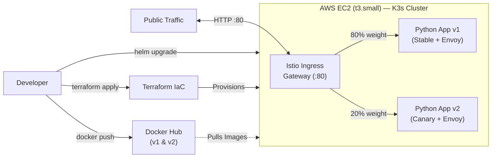
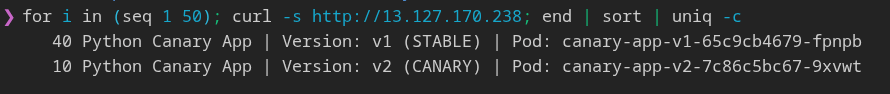
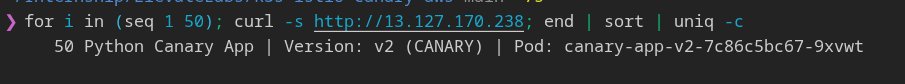
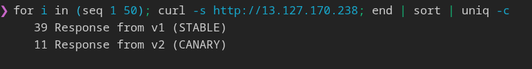
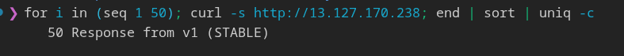

# Kubernetes Canary Deployment with K3s, Istio & Helm on AWS

Progressive traffic splitting, live canary promotion, and zero-downtime rollbacks on a lightweight **K3s** cluster provisioned on **AWS EC2 (`t3.small`)** with **Terraform**, **Istio Service Mesh**, **Docker**, and **Helm**.

## Architecture



## Tech Stack

- **Infrastructure as Code:** Terraform (AWS EC2 `t3.small`, Security Groups, IAM Instance Profile for AWS SSM)
- **Container Orchestration:** K3s (with built-in Traefik disabled so Istio Ingress Gateway binds directly to port `80`)
- **Service Mesh & Traffic Routing:** Istio (`demo` profile tuned for 2 GiB RAM, `Gateway`, `DestinationRule`, `VirtualService`)
- **Application & Packaging:** Custom Python HTTP service (`v1` Stable & `v2` Canary Docker images) packaged as a parameterized **Helm** chart

## Repository Structure

```text
k3s-istio-canary-aws/
├── terraform/              # AWS EC2, Security Group, and IAM (SSM) provisioning
├── k8s/                    # Phase 1: Baseline Kubernetes Deployments & Service
├── istio/                  # Phase 1: Baseline Istio Gateway, DestinationRule & VirtualService
├── app/                    # Phase 2: Custom Python HTTP server & multi-arg Dockerfile
├── charts/canary-app/      # Phase 2: Parameterized Helm chart for canary weight management
├── screenshots/            # Traffic split, promotion, and rollback verification logs
├── CANARY_STRATEGY.md      # Progressive rollout gates, SLO thresholds, and rollback policy
└── README.md
```

## Deployment Workflow

### 1. Provision Infrastructure & Install K3s
```bash
cd terraform && terraform init && terraform apply -auto-approve
```
Connect via AWS SSM and install K3s with Traefik disabled:
```bash
curl -sfL [https://get.k3s.io](https://get.k3s.io) | INSTALL_K3S_EXEC="--tls-san <EC2_PUBLIC_IP> --disable=traefik" sh -
```

### 2. Install Istio & Enable Sidecar Injection
```bash
istioctl install --set profile=demo --set components.egressGateways[0].enabled=false -y
kubectl create namespace canary-demo
kubectl label namespace canary-demo istio-injection=enabled
```

### 3. Deploy with Helm (80% Stable / 20% Canary)
```bash
helm install canary-release ./charts/canary-app -n canary-demo
```

### 4. Promote Canary & Roll Back via Helm
- **Promote `v2` to 100% traffic:**
  ```bash
  helm upgrade canary-release ./charts/canary-app -n canary-demo \
    --set stable.weight=0 --set canary.weight=100
  ```
- **Instant rollback to previous revision:**
  ```bash
  helm rollback canary-release 1 -n canary-demo
  ```

## Verification Results

### Helm-Managed Python Canary Split (80% Stable / 20% Canary)


### Live Canary Promotion (100% v2 Traffic)


### Baseline Manifests: 80/20 Split & Instant Rollback to v1
| 80/20 Initial Split | 100% Rollback to v1 |
| :---: | :---: |
|  |  |

---

## Author

**Sujal Surani** — Cloud & DevOps Engineer  
Architected and maintained with Terraform, K3s, and Istio on AWS.

[GitHub](https://github.com/sujal-surani) · [LinkedIn](https://www.linkedin.com/in/sujal-surani)